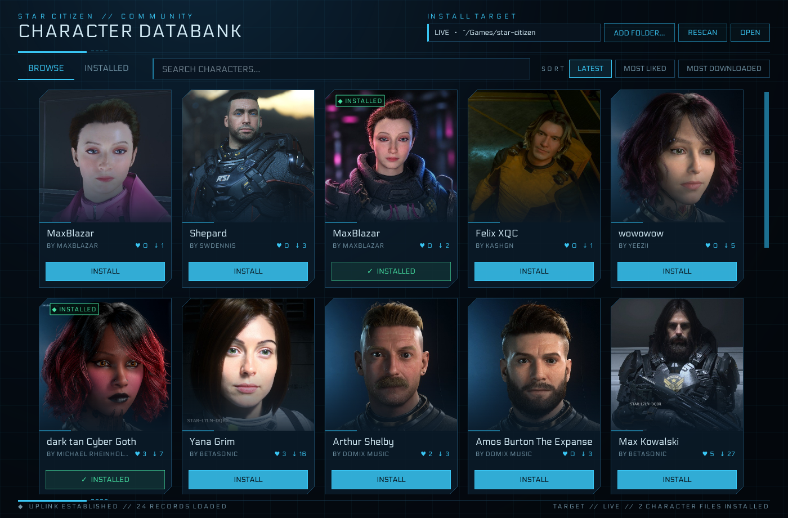
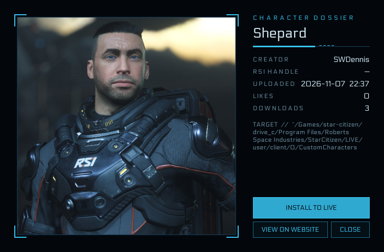
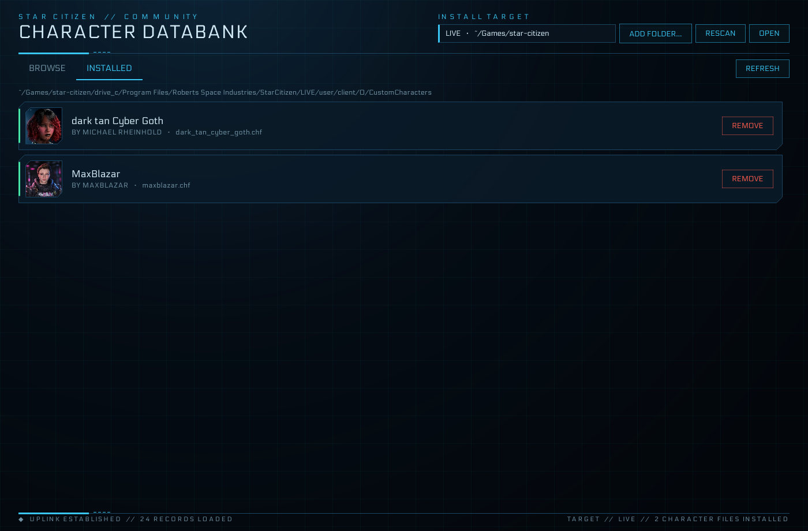

# SC Character Databank

A native Linux (and Windows) app for browsing the community character submissions on
[star-citizen-characters.com](https://www.star-citizen-characters.com/) and installing them
into Star Citizen with one click. It is built with Qt 6 (PySide6), runs natively on Wayland
(X11 works too), and is styled after Star Citizen's own interface.



| Character details | Installed characters |
|---|---|
|  |  |

## Features

- **Browse like on the website:** search, and sort by *Latest*, *Most liked* or
  *Most downloaded*. More results load as you scroll.
- **One-click install and removal.** Characters go into
  `<channel>/user/client/0/CustomCharacters/` under the same file name the website gives them.
  When two characters would share a name, the second one gets a `_2` suffix instead of
  overwriting the first.
- **Finds your game automatically:**
  - Proton prefixes (`steamapps/compatdata/*/pfx`) in every Steam library listed in
    `libraryfolders.vdf`, for native, Flatpak and Snap Steam
  - Wine prefixes under `~/Games`, up to three levels deep (for example the
    [LUG Helper](https://github.com/starcitizen-lug/lug-helper) / Lutris default
    `~/Games/star-citizen`), including Steam libraries kept there
  - `~/.wine`
  - On Windows: the RSI launcher's default location on every drive, plus custom library
    folders found in the launcher's logs
  - The LIVE, PTU, EPTU, TECH-PREVIEW and HOTFIX channels
- **Add Folder…** for any other location. You can pick the Wine prefix, the `StarCitizen`
  folder, a channel folder such as `LIVE`, or `CustomCharacters` itself.
- **Installed tab** listing every `.chf` file in the selected channel, including files you
  added by hand.
- Each install is reported to the website's download counter, the same request its own
  download button sends.

## Install

### Arch Linux

From the `[geeks.gay]` repository (setup instructions at
[repo.geeks.gay](https://repo.geeks.gay)):

```sh
sudo pacman -S scc-browser
```

Or build it yourself with [`packaging/arch/PKGBUILD`](packaging/arch/PKGBUILD).

### Windows

Download `scc-browser-<version>-windows-x64.zip` from the
[latest release](https://github.com/cptn-cosmo/scc-browser/releases/latest), extract it anywhere
and run `scc-browser.exe`. The build is unsigned, so SmartScreen may ask for confirmation the
first time.

### From source

Needs Python 3.10+ and PySide6 6.5+ (on Arch: `pacman -S pyside6 qt6-wayland`).

```sh
python -m scc_browser          # run from the checkout
pip install .                  # or install the scc-browser command
```

Shortcuts: `Ctrl+F` search, `F5` reload.

## Files

| What | Linux | Windows |
|---|---|---|
| Settings (selected target, added folders, sort order) | `~/.config/scc-browser/scc-browser.conf` | registry, `HKCU\Software\scc-browser` |
| Which characters this app installed | `~/.local/share/scc-browser/installed.json` | `%APPDATA%\scc-browser\installed.json` |
| Image cache | `~/.cache/scc-browser/scc-browser/` | `%LOCALAPPDATA%\scc-browser\scc-browser\cache\` |

## Development

```sh
QT_QPA_PLATFORM=offscreen python -m pytest
```

To release: bump the version in `pyproject.toml`, `scc_browser/__init__.py`,
`data/gay.geeks.sccbrowser.metainfo.xml` and `packaging/arch/PKGBUILD`, tag `vX.Y.Z`, attach
`git archive --prefix=scc-browser-X.Y.Z/ vX.Y.Z` as `scc-browser-X.Y.Z.tar.gz` to the GitHub
release, then run `updpkgsums` in `packaging/arch/`. Publishing the release makes CI build the
Windows zip (`packaging/windows/scc-browser.spec`) and attach it.

## License

GPL-3.0-or-later. The bundled [Electrolize](https://fonts.google.com/specimen/Electrolize)
font is © Cyreal and licensed under the SIL Open Font License 1.1
(`scc_browser/assets/OFL.txt`).

Star Citizen® is a trademark of Cloud Imperium Rights LLC. This project is not affiliated
with Cloud Imperium Games or star-citizen-characters.com. Character files and previews
belong to their creators.
